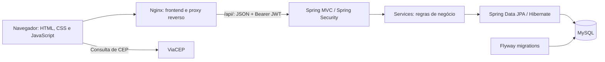
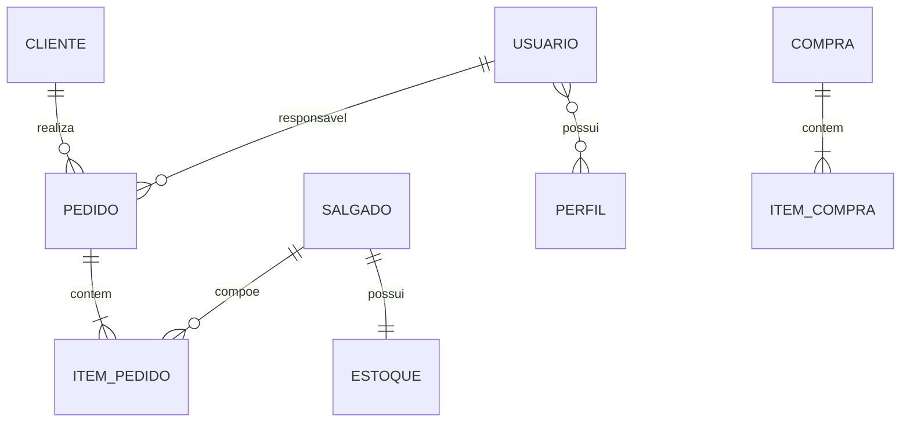

# Sistema Salgados da Lúcia

> Sistema de gestão comercial da **Salgados da Lúcia Kojima**, com interface web e API REST para clientes, catálogo,
> estoque, pedidos, compras e usuários.

[](https://openjdk.org/projects/jdk/21/)
[](https://spring.io/projects/spring-boot)
[](https://www.mysql.com/)


**Quer testar?** Siga o [passo a passo com Docker](#executar-com-docker--recomendado), do clone ao primeiro login.

## Contexto

A salgadaria recebe pedidos por canais como WhatsApp e realiza entregas na região de São Paulo e ABC Paulista. O sistema
centraliza o cadastro de clientes, o catálogo, a agenda de entregas, o acompanhamento de pedidos, as compras de insumos
e o estoque de salgados.

O repositório reúne o **backend em Java/Spring Boot** e o **frontend em HTML, CSS e JavaScript puro**, integrado à API.
As telas operacionais já estão implementadas; a página inicial ainda é uma estrutura básica, sem indicadores ou
relatórios.

## Funcionalidades

### Interface web

| Tela               | Recursos implementados                                                                                                                                                                                                                                                                                    |
|--------------------|-----------------------------------------------------------------------------------------------------------------------------------------------------------------------------------------------------------------------------------------------------------------------------------------------------------|
| Login              | Autenticação por usuário e senha, armazenamento dos tokens e abertura do painel após o login.                                                                                                                                                                                                             |
| Clientes           | Cadastro com endereço, preenchimento por CEP via ViaCEP, listagem paginada, busca por nome, consulta de ativos/inativos, detalhes em modal, edição no formulário de cadastro e ativação/desativação por modal.                                                                                                                               |
| Salgados e Estoque | Cadastro de nome, descrição, categoria e preços por cento para congelados/processados; busca por nome, paginação, ativos/inativos, detalhes em modal, edição no formulário de cadastro, alteração de status e ajuste de estoque.                                                                                                             |
| Pedidos            | Cadastro e edição, seleção de cliente e salgados, inclusão/remoção de itens, quantidades, tipo de preço, prévia de subtotais e total, frete, data/hora de entrega, entrega ou retirada e forma de pagamento. Histórico paginado, filtros por status e período de entrega, detalhes e alteração de status. |
| Compras            | Cadastro e edição de compras de insumos, inclusão/remoção de itens com quantidade e valor unitário, prévia do total, data e observação. Histórico paginado, filtro por período e detalhes em modal.                                                                                                       |
| Usuários           | Cadastro com perfil de acesso, listagem paginada, busca por nome, consulta de ativos/inativos, desativação e alteração da própria senha com confirmação.                                                                                                                                                  |

A navegação lateral carrega as telas sem recarregar a página inteira. Cards, formulários e modais têm templates
próprios; o modal compartilhado pode ser fechado pelo botão, pelo fundo ou pela tecla `Esc`. A interface utiliza
formatação monetária brasileira e estilos com ajustes para telas menores.

### API e regras de negócio

- Autenticação stateless com JWT e endpoint de renovação de tokens.
- Perfis `ADMIN` e `FUNCIONARIO`, com herança das permissões de funcionário pelo administrador.
- Senhas armazenadas com BCrypt e validação da senha atual na troca de senha.
- Cadastro de salgados com criação automática do respectivo estoque.
- Ajustes de estoque por variação positiva ou negativa, sem permitir saldo final negativo.
- Pedidos associados a clientes, salgados e responsáveis ativos; edição permitida apenas para pedidos `EM_ANDAMENTO`.
- No cadastro e na edição de pedidos, entrega exige endereço completo informado; retirada mantém endereço nulo. A tela preenche os campos com o endereço do cliente para conferência, mas a API não aplica esse preenchimento automaticamente. Veja as [regras de pedidos](https://github.com/matheus-vsm/SistemaSalgadosDaLucia/wiki/3-%E2%80%90-Regras-de-Neg%C3%B3cio#pedidos).
- Cálculo do preço unitário a partir do preço por cento, subtotais dos itens e total do pedido com frete.
- Compras com recálculo de subtotais e total no cadastro e na edição.
- Paginação e filtros, validação de dados, tratamento centralizado de exceções e DTOs para os contratos HTTP.
- Endpoints de enums para preencher categorias, perfis e opções dos pedidos no frontend.
- Migrações de banco com Flyway e documentação da API com Swagger/OpenAPI.

## Tecnologias

| Camada                  | Tecnologias                                                             |
|-------------------------|-------------------------------------------------------------------------|
| Frontend                | HTML5, CSS3, JavaScript puro, Fetch API, Local Storage                  |
| Consulta de CEP         | ViaCEP                                                                  |
| Backend                 | Java 21, Spring Boot 3.5.15, Spring Web, Bean Validation, Lombok        |
| Segurança               | Spring Security, BCrypt, JWT com Auth0 Java JWT                         |
| Persistência            | Spring Data JPA, Hibernate, MySQL, Flyway                               |
| Documentação da API     | Springdoc OpenAPI e Swagger UI                                          |
| Build e desenvolvimento | Maven Wrapper (Maven 3.9.12), Spring Boot DevTools, H2 no perfil `fora` |
| Dependências de teste   | Spring Boot Test e Spring Security Test                                 |

O frontend não exige framework, instalação de pacotes npm ou etapa de build. Ele deve ser servido por HTTP, pois carrega
os módulos e templates com `fetch`.

## Arquitetura

O backend segue **package by feature**: cada domínio agrupa controllers, services, repositories, entidades, mappers e
DTOs. O frontend também é organizado por funcionalidade, com arquivos HTML, CSS e JavaScript separados por módulo.



### Organização do frontend

- [`frontend/index.html`](frontend/index.html): tela de login, estrutura do painel, menu e modal compartilhado.
- [`frontend/app.js`](frontend/app.js): login e carregamento dinâmico de HTML, CSS e scripts dos módulos. O evento
  `pagina:carregada` inicia cada tela.
- [`frontend/js/api.js`](frontend/js/api.js): endereço base da API, envio de JSON e Bearer token, leitura de respostas e
  limpeza dos tokens em respostas `401`. `apiJson` retorna `{ response, data }` nos sucessos e lança `ApiError`
  nas falhas HTTP, preservando o `message` enviado pelo backend (com compatibilidade para `mensagem`).
- [`frontend/js/notificacoes.js`](frontend/js/notificacoes.js): notificações compartilhadas de sucesso, erro e aviso.
  `mostrarNotificacao({ tipo, titulo, mensagem })` exibe um cartão; `notificarErro(titulo, erro)` preserva a mensagem
  da API e devolve o texto para reutilização nos estados de erro das telas. Os estilos ficam em `frontend/css/notificacoes.css`.
- [`frontend/js/modal.js`](frontend/js/modal.js): abertura e fechamento do modal reutilizável.
- [`frontend/js/viacep.js`](frontend/js/viacep.js): consulta de endereço por CEP.
- Pastas dos módulos: templates de páginas, cards, itens e modais, estilos específicos e lógica de integração com a API.

### Domínio principal



## Executar com Docker — recomendado

Este é o caminho mais simples para testar o sistema: Docker prepara **frontend, API e banco de dados**.
Você não precisa instalar Java, Maven, MySQL ou Nginx separadamente.

### 1. Prepare o ambiente e baixe o projeto

- Instale o [Git](https://git-scm.com/downloads) e o [Docker Desktop](https://www.docker.com/products/docker-desktop/)
  (Windows/macOS) ou Docker Engine com o plugin Docker Compose (Linux).
- Inicie o Docker e use containers Linux. Confira com `docker info` e `docker compose version`.
- Tenha internet para baixar imagens e dependências no primeiro build e um navegador para acessar o sistema.

Os comandos partem da raiz do projeto, onde está `compose.yaml`. Use PowerShell no Windows ou Bash no Linux/macOS.

```sh
git clone https://github.com/matheus-vsm/SistemaSalgadosDaLucia.git
cd SistemaSalgadosDaLucia
```

### 2. Configure o arquivo .env

Copie o exemplo **somente no primeiro uso**; se já existe `.env`, preserve-o.

**PowerShell:**

```powershell
Copy-Item .env.example .env
```

**Bash:**

```bash
cp .env.example .env
```

Abra `.env` em um editor de texto e preencha as três linhas vazias:

| Variável | O que preencher |
| --- | --- |
| `DB_PASSWORD` | Uma senha escolhida para o usuário da aplicação no banco |
| `DB_ROOT_PASSWORD` | Outra senha para o administrador do MySQL |
| `JWT_HMC256` | Um segredo longo e aleatório para assinar os tokens de login |

Use valores próprios, sem espaços, `$` ou `#`, para simplificar a configuração local. Não compartilhe nem versione `.env`.
Mantenha os demais valores do exemplo: `DB_NAME=salgados_lucia`, `DB_USER=salgados_app`,
`JWT_ISSUER=salgados-da-lucia-kojima`, `BACKEND_URL=http://backend:8080` e `FRONTEND_PORT=5500`.
O Compose lê `.env` automaticamente; não é necessário carregar suas variáveis no terminal.
Se você já definiu variáveis com esses nomes no terminal, elas têm prioridade sobre o arquivo; remova-as antes de continuar.

### 3. Suba o sistema

```sh
docker compose config --quiet
docker compose up -d --build --wait
docker compose ps
```

O primeiro comando valida a configuração e não imprime nada quando ela está correta. Se houver erro, corrija-o antes de continuar.
O primeiro build pode demorar vários minutos. Aguarde o comando terminar com sucesso: `--wait` espera os serviços
ficarem saudáveis. `docker compose ps` deve mostrar `db`, `backend` e `frontend` em execução e com estado `healthy`.

### 4. Crie o primeiro administrador

Não existe usuário ou senha padrão. Crie seu administrador **uma única vez**, depois que a subida terminar.
O bootstrap abaixo é a opção recomendada; há também uma alternativa por INSERT ao final desta etapa.
Escolha nome, username e senha nos prompts; não são as credenciais do banco configuradas no `.env`.
Execute o bloco correspondente ao seu terminal, ainda na raiz do projeto.

**Windows — PowerShell:**

```powershell
$env:BOOTSTRAP_ADMIN_NAME = Read-Host 'Nome do administrador'
$env:BOOTSTRAP_ADMIN_USERNAME = Read-Host 'Username para login'
$adminPassword = Read-Host 'Senha para login' -AsSecureString
$env:BOOTSTRAP_ADMIN_PASSWORD = [System.Net.NetworkCredential]::new('', $adminPassword).Password
try {
    docker compose run --rm --no-deps -e "SPRING_PROFILES_ACTIVE=prod,bootstrap-admin" -e BOOTSTRAP_ADMIN_NAME -e BOOTSTRAP_ADMIN_USERNAME -e BOOTSTRAP_ADMIN_PASSWORD backend
} finally {
    Remove-Item Env:BOOTSTRAP_ADMIN_NAME, Env:BOOTSTRAP_ADMIN_USERNAME, Env:BOOTSTRAP_ADMIN_PASSWORD
    $adminPassword = $null
}
```

**Linux/macOS — Bash** (se estiver usando outro shell, abra `bash` antes):

```bash
(
    read -r -p 'Nome do administrador: ' BOOTSTRAP_ADMIN_NAME
    read -r -p 'Username para login: ' BOOTSTRAP_ADMIN_USERNAME
    read -r -s -p 'Senha para login: ' BOOTSTRAP_ADMIN_PASSWORD
    printf '\n'
    export BOOTSTRAP_ADMIN_NAME BOOTSTRAP_ADMIN_USERNAME BOOTSTRAP_ADMIN_PASSWORD
    docker compose run --rm --no-deps -e SPRING_PROFILES_ACTIVE=prod,bootstrap-admin -e BOOTSTRAP_ADMIN_NAME -e BOOTSTRAP_ADMIN_USERNAME -e BOOTSTRAP_ADMIN_PASSWORD backend
)
```

A senha não aparece enquanto é digitada. No PowerShell, as variáveis temporárias são removidas ao final;
no Bash, ficam restritas ao subshell entre parênteses e desaparecem quando ele termina.
Aguarde a mensagem **Administrador criado**. O comando cria o usuário com perfil `ADMIN` e encerra;
não é outro servidor para deixar aberto. Uma nova execução com o mesmo username falha e não redefine a senha.
Use nome de até 100 caracteres, username de até 50 e senha não vazia de até 72 bytes UTF-8.

<details>
<summary>Alternativa: criar o primeiro usuário com INSERT no banco</summary>

#### Alternativa: criar o primeiro usuário com INSERT

Se preferir executar SQL, use esta opção **no lugar do bootstrap**, após a subida dos containers.
O usuário precisa estar ativo, ter senha em **BCrypt** e estar associado ao perfil `ADMIN`.
Não grave a senha em texto puro nem use `MD5`, `SHA` ou `PASSWORD()` do MySQL.

1. Gere o hash localmente com um container auxiliar (o comando funciona em PowerShell e Bash):

```sh
docker run --rm -it httpd:2.4-alpine htpasswd -nBC 10 admin_sql
```

Digite e confirme a senha de login (até 72 bytes UTF-8). A imagem é baixada no primeiro uso; o container termina depois de gerar o hash.
Da saída `admin_sql:$2y$10$...`, copie **somente o hash completo depois de `admin_sql:`**, incluindo os `$`.

2. Abra o MySQL do projeto, ainda na raiz do repositório:

```sh
docker compose exec db sh -c 'exec mysql -u"$MYSQL_USER" -p "$MYSQL_DATABASE"'
```

Quando pedir a senha, informe `DB_PASSWORD` do `.env`. Não é a senha de login que você acabou de escolher.
O comando usa o cliente dentro do container; não precisa instalar MySQL nem publicar a porta 3306.

3. No prompt `mysql>`, substitua `<HASH_BCRYPT_DA_SUA_SENHA>` pelo hash gerado e execute:

```sql
START TRANSACTION;

INSERT INTO usuarios (nome, username, senha, ativo)
VALUES ('Administrador', 'admin_sql', '<HASH_BCRYPT_DA_SUA_SENHA>', TRUE);

SET @novo_usuario_id = LAST_INSERT_ID();

INSERT INTO usuarios_perfis (usuario_id, perfil_id)
SELECT @novo_usuario_id, id FROM perfis WHERE nome = 'ADMIN';

SELECT u.id, u.username, u.ativo, p.nome AS perfil
FROM usuarios u
JOIN usuarios_perfis up ON up.usuario_id = u.id
JOIN perfis p ON p.id = up.perfil_id
WHERE u.id = @novo_usuario_id;
```

Você pode trocar `Administrador` e `admin_sql` pelo nome e username desejados, respeitando os limites de 100 e 50 caracteres.
O perfil `ADMIN` já é criado pelas migrações. Se as duas inserções terminarem sem erro e a consulta mostrar o username escolhido,
`ativo = 1` e `perfil = ADMIN`, confirme:

```sql
COMMIT;
```

Se houver qualquer erro ou a conferência não corresponder, execute `ROLLBACK;` em vez de `COMMIT;` e corrija os valores.
Não repita a inserção de um username já cadastrado. Saia com `exit;` e faça login com o username escolhido e a senha original,
**não com o hash**.

</details>

### 5. Abra o sistema e faça login

Acesse [http://127.0.0.1:5500](http://127.0.0.1:5500) e entre com o **username e a senha que acabou de escolher**.
O banco começa sem cadastros de negócio; você pode cadastrar clientes e salgados para experimentar as telas.

Para parar e voltar a usar depois, na mesma pasta:

```sh
docker compose stop
docker compose start --wait
```

Os dados e o administrador continuam salvos. Não use `docker compose down -v`: ele apaga o banco.
Veja [diagnóstico e operação do Docker](https://github.com/matheus-vsm/SistemaSalgadosDaLucia/wiki/10-Docker-e-operacao-do-MVP#solução-de-problemas)
se algo falhar. Publicação em servidor é um procedimento separado deste teste local.

## Alternativa: executar sem Docker

Use esta opção se quiser desenvolver com Java, MySQL e Nginx instalados na máquina.
Para apenas experimentar o sistema, siga o roteiro Docker acima.

### Pré-requisitos

- JDK 21 e `JAVA_HOME` configurado.
- MySQL 8+ para o perfil padrão.
- Navegador, PowerShell e distribuição oficial do Nginx para Windows para servir o frontend e encaminhar a API.
- Acesso à internet no primeiro uso do Maven Wrapper para baixar Maven e dependências, e para a consulta de CEP.

Os comandos abaixo usam PowerShell e partem da raiz do repositório, exceto quando indicado.

### 1. Configure o backend

Defina as variáveis no terminal em que o backend será iniciado, substituindo os valores de exemplo:

```powershell
$env:DB_NAME="salgados_lucia"
$env:DB_USER="seu_usuario_mysql"
$env:DB_PASSWORD="sua_senha_mysql"
$env:JWT_HMC256="substitua-por-um-segredo-local"
$env:JWT_ISSUER="salgados-da-lucia-kojima"
```

A configuração padrão conecta ao MySQL em `localhost:3306`. O usuário do banco precisa das permissões necessárias para
criar o banco, caso ainda não exista, e aplicar as migrações.

O `TokenService` usa `JWT_HMC256` para assinar e verificar os tokens e `JWT_ISSUER` como emissor.
Configure um segredo forte no ambiente do backend. Ao trocar esse segredo, os tokens anteriores deixam de ser válidos.

Em ambientes já configurados, renomeie as chaves conforme o `.env.example`, mantendo os valores atuais.
No Compose, `DB_ROOT_PASSWORD` é repassada como `MYSQL_ROOT_PASSWORD`, exigida pela imagem oficial do MySQL.

Se as variáveis estiverem em um `.env` local na raiz, carregue-o no mesmo terminal antes de iniciar o backend:

```powershell
Get-Content .env | Where-Object { $_ -match '^[A-Za-z_][A-Za-z0-9_]*=' } | ForEach-Object {
    $nome, $valor = $_ -split '=', 2
    Set-Item -LiteralPath "Env:$nome" -Value $valor
}
```

O Spring Boot não carrega `.env` automaticamente. Esse comando também substitui variáveis antigas do terminal
que já usem os novos nomes. Para Compose, use um usuário de aplicação diferente de `root` em `DB_USER`
e configure `DB_ROOT_PASSWORD` separadamente.

### 2. Inicie a API

```powershell
cd backend
.\mvnw.cmd spring-boot:run
```

Se já houver Maven instalado, pode usar `mvn spring-boot:run` dentro de `backend`. Em Linux/macOS, o wrapper equivalente
é `./mvnw`.

A URL base completa é:

```text
http://localhost:8080/api/salgados-da-lucia-kojima
```

O Flyway aplica as migrações de [`backend/src/main/resources/db/migration`](backend/src/main/resources/db/migration) na
inicialização do perfil padrão.

### 3. Prepare o primeiro acesso

Não há usuário ou senha padrão nem criação automática de administrador na subida normal. Para criar o primeiro
administrador com Docker, veja as [opções de provisionamento](https://github.com/matheus-vsm/SistemaSalgadosDaLucia/wiki/10-Docker-e-operacao-do-MVP#primeiro-administrador).
No fluxo manual sem containers, é necessário
provisionar um usuário ativo na tabela `usuarios`, com senha codificada em BCrypt, e associá-lo ao perfil `ADMIN` pela
tabela `usuarios_perfis`.

No MySQL, a migração `V14` já cadastra os perfis `ADMIN` e `FUNCIONARIO`. O cadastro de novos usuários pela API ou pela
interface exige um administrador autenticado, portanto não substitui esse provisionamento inicial.

### 4. Inicie o frontend

Baixe o ZIP para Windows pela [página oficial do Nginx](https://nginx.org/en/download.html) e extraia-o, por exemplo,
em `C:\nginx`. A pasta escolhida deve conter `nginx.exe` e `conf\mime.types`. O executável não é versionado.
Também pode usar uma pasta dentro de `.tools/`, que está ignorada pelo Git.

Em outro terminal PowerShell, na raiz do repositório, ajuste o diretório da instalação e execute:

```powershell
$nginxHome = 'C:\nginx'
$env:BACKEND_URL = 'http://127.0.0.1:8080'
.\infra\nginx\nginx.ps1 -Action test -NginxHome $nginxHome
.\infra\nginx\nginx.ps1 -Action start -NginxHome $nginxHome
```

Abra [o painel local](http://127.0.0.1:5500) e entre com um usuário previamente cadastrado. Encerre o Python ou Live Server
se estiverem usando a porta 5500. Caso a política local bloqueie scripts, você pode executar o auxiliar em um processo
PowerShell com `powershell -NoProfile -ExecutionPolicy Bypass -File .\infra\nginx\nginx.ps1 -Action start -NginxHome C:\nginx`.
Isso vale apenas para esse processo, sem alterar a política persistente do computador.

O Nginx escuta somente em `127.0.0.1:5500`, serve a pasta `frontend` e encaminha `/api/` para o endereço de `BACKEND_URL`,
preservando o caminho, os parâmetros, o corpo e o cabeçalho `Authorization`. O navegador chama
`/api/salgados-da-lucia-kojima` pela mesma origem do painel; não precisa conhecer o host ou a porta do Spring.
A configuração de CORS do backend foi mantida.

Defina `BACKEND_URL` no terminal que executa o auxiliar. Se não estiver definida, será usado `http://127.0.0.1:8080`
para desenvolvimento local. Informe somente protocolo (`http` ou `https`), host e porta, por exemplo
`http://192.168.0.10:8080`; não inclua `/api/salgados-da-lucia-kojima`, credenciais, query ou fragmento.
Uma barra final é removida pelo auxiliar para preservar o caminho da requisição.
O auxiliar lê a variável ao executar `test`, `start` ou `reload` e a grava na configuração local gerada;
o Nginx não faz essa substituição diretamente. Para mudar o destino de uma instância em execução, defina a variável
nesse terminal e execute `reload`. A variável muda o destino do proxy, não o endereço em que o Spring Boot escuta.

O auxiliar resolve os caminhos locais a partir da localização do repositório e da instalação do Nginx. A configuração
gerada, os logs e o PID ficam em `infra/nginx/.runtime/`, ignorado pelo Git. Ele pode ser executado de outro diretório
informando o caminho do script. Para modificar o comportamento, edite `infra/nginx/nginx.conf.template`, não o arquivo gerado.

```powershell
# Valida antes de aplicar a configuração e recarrega sem derrubar a instância.
.\infra\nginx\nginx.ps1 -Action reload -NginxHome $nginxHome

# Encerra apenas a instância iniciada com a configuração deste projeto.
.\infra\nginx\nginx.ps1 -Action stop -NginxHome $nginxHome
```

Arquivos inexistentes retornam `404`, sem fallback para o HTML de login. Arquivos estáticos usam `Cache-Control: no-cache`
para revalidar versões, pois seus nomes não possuem hashes. O proxy não configura cache da API e preserva suas respostas
de erro. A consulta de CEP continua sendo feita diretamente ao ViaCEP.

**Diagnóstico:**

- **Porta 5500 ocupada:** use `Get-NetTCPConnection -State Listen -LocalPort 5500` para identificar o processo e encerre o
  servidor que já estava usando a porta. Não inicie outra instância por cima dele.
- **502 Bad Gateway:** confirme que o backend está acessível no endereço definido em `BACKEND_URL`
  (padrão local: `http://127.0.0.1:8080`); consulte `infra/nginx/.runtime/logs/error.log`.
- **404 em arquivo:** confira o caminho solicitado no navegador e a presença do arquivo dentro de `frontend`.
  O acesso a arquivos ocultos, à pasta de testes e a arquivos fora do frontend não é servido.
- **PID antigo:** confirme se o processo indicado em `infra/nginx/.runtime/logs/nginx.pid` ainda existe antes de remover
  um PID deixado por uma interrupção. Use o auxiliar para gerenciar esta instância.

Python e Live Server, sozinhos, não encaminham `/api/` e não substituem esse fluxo manual.
No Docker Compose, o proxy já usa `BACKEND_URL=http://backend:8080`; `127.0.0.1` dentro do container seria o próprio Nginx.
Domínio, HTTPS e hospedagem não são necessários para o teste local com Docker.

O Nginx para Windows é usado aqui para validação local; a [documentação oficial registra limitações dessa versão](https://nginx.org/en/docs/windows.html).
Esta integração não é uma auditoria de prontidão para produção.

Não abra `index.html` diretamente por `file://`: o carregamento dos templates depende de um servidor HTTP.

### Alternativa: banco H2 em memória

Dentro de `backend`, com as variáveis JWT definidas:

```powershell
.\mvnw.cmd spring-boot:run "-Dspring-boot.run.profiles=fora"
```

O perfil `fora` usa `jdbc:h2:mem:salgados_lucia;DB_CLOSE_DELAY=-1;MODE=MySQL`, usuário `sa` e senha vazia. O Hibernate
cria as tabelas e os dados são temporários; o Flyway fica desabilitado. Por isso, os perfis e o primeiro administrador
também precisam ser provisionados nesse ambiente.

O console H2 é habilitado em `/api/salgados-da-lucia-kojima/h2-console`, mas a configuração atual de segurança não
libera essa rota nem configura os frames do console. O perfil, por si só, não garante acesso ao console pelo navegador.

## Autenticação e permissões

As rotas abaixo são relativas à URL base da API. Os endpoints de `/autenticacao/**`, os diagnósticos de saúde do Actuator
e a documentação Swagger/OpenAPI (quando habilitada) dispensam autenticação no Spring. O Nginx bloqueia o Actuator;
as demais rotas exigem autenticação.

```http
POST /api/salgados-da-lucia-kojima/autenticacao/login
Content-Type: application/json

{ "username": "seu_usuario", "senha": "sua_senha" }
```

A resposta contém `tokenAcesso` e `refreshToken`. Para chamadas protegidas:

```http
Authorization: Bearer <token_de_acesso>
```

Usuários inativos não podem fazer login, renovar tokens ou usar tokens já emitidos. O token de acesso
expira em 60 minutos e o refresh em 120 minutos; cada um tem finalidade própria e não pode substituir o outro.
Tokens antigos sem a identificação de finalidade exigem novo login após a atualização.

A renovação está disponível por `POST /autenticacao/atualizar-token`, com o corpo:

```json
{
  "refreshToken": "seu_refresh_token"
}
```

O refresh pode ser reutilizado até expirar, enquanto o usuário existir e estiver ativo; a renovação não
revoga o token anterior. Tokens emitidos no mesmo segundo podem ter conteúdo idêntico. O endpoint retorna
`400` para refresh inválido, `401` para usuário inativo e `404` para usuário removido. Credenciais inválidas
no filtro de acesso retornam `401` no formato JSON de erro da API. A ausência de credenciais em rota protegida
mantém a resposta `403` da configuração de segurança. Veja a [matriz da revisão de autenticação na wiki](https://github.com/matheus-vsm/SistemaSalgadosDaLucia/wiki/9-%E2%80%90-Testes-e-Rastreabilidade)
para cenários, decisões e limites da validação.

| Perfil        | Permissões na API                                                                                                      |
|---------------|------------------------------------------------------------------------------------------------------------------------|
| `FUNCIONARIO` | Gerenciar clientes, pedidos, compras e ajustes de estoque; consultar salgados e usuários; alterar a própria senha.     |
| `ADMIN`       | Todas as permissões de funcionário, além de cadastrar/editar/ativar/desativar salgados e cadastrar/desativar usuários. |

A autorização é aplicada pelo backend. O menu do frontend é compartilhado entre os perfis e não oculta todas as ações
restritas ao administrador.

No navegador, os tokens ficam no `localStorage`. A renovação automática ainda não está integrada: ao receber `401`, o
cliente HTTP limpa os tokens e informa que é necessário entrar novamente. Também não há botão de logout nem restauração
automática do painel ao recarregar a página.

## Rotas da API

Prefixo de todas as rotas: `/api/salgados-da-lucia-kojima`.

| Recurso      | Operações                                                                                                                                                              |
|--------------|------------------------------------------------------------------------------------------------------------------------------------------------------------------------|
| Autenticação | `POST /autenticacao/login`, `POST /autenticacao/atualizar-token`                                                                                                       |
| Clientes     | `POST /clientes`, `GET /clientes`, `GET /clientes/{id}`, `GET /clientes/nome?nome=...&ativo=true`, `PUT /clientes/{id}`, `PATCH /clientes/{id}`                                      |
| Salgados     | `POST /salgados`, `GET /salgados`, `GET /salgados/{id}`, `GET /salgados/nome?nome=...&ativo=true`, `PUT /salgados/{id}`, `PATCH /salgados/{id}`                                      |
| Estoque      | `GET /estoque`, `GET /estoque/{salgadoId}`, `PATCH /estoque/{salgadoId}`                                                                                               |
| Pedidos      | `POST /pedidos`, `GET /pedidos`, `GET /pedidos/{id}`, `PUT /pedidos/{id}`, `PATCH /pedidos/{id}`                                                                       |
| Compras      | `POST /compras`, `GET /compras`, `GET /compras/{id}`, `PUT /compras/{id}`                                                                                              |
| Usuários     | `POST /usuarios/cadastrar`, `GET /usuarios`, `GET /usuarios/nome?nome=`, `GET /usuarios/{id}`, `PATCH /usuarios` (própria senha), `PATCH /usuarios/{id}` (desativação) |
| Enums        | `GET /enums/pedido`, `GET /enums/salgado`, `GET /enums/usuario`                                                                                                        |

### Paginação e filtros

As listagens paginadas aceitam `page`, `size` e `sort`, com páginas começando em zero. As listagens gerais de clientes,
salgados e usuários exigem `ativo=true` ou `ativo=false`. As buscas por nome de clientes e salgados também exigem esse parâmetro e aplicam nome e status antes da paginação.

- **Pedidos:** `statusPedido`, `clienteId`, `nomeCliente`, `dataPedido`, `dataInicioEntrega`, `dataFimEntrega`,
  `tipoEntrega`, `formaPagamento`, `usuarioResponsavelId` e `nomeUsuarioResponsavel`. Os limites do período de entrega
  usam `dd-MM-yyyy HH:mm:ss` na query string.
- **Compras:** `dataInicioCompra`, `dataFimCompra`, `nomeItem` e `observacao`. As datas dos filtros usam `dd-MM-yyyy`.
- Quando apenas o início de um período é informado, a API consulta aquele dia. As telas convertem as datas dos
  formulários para os formatos esperados.

### Exemplo: criar pedido

Envie para `POST /pedidos`, com IDs de registros ativos e uma data de entrega futura:

```json
{
  "clienteId": 1,
  "itens": [
    {
      "salgadoId": 1,
      "quantidade": 100,
      "tipoPreco": "CONGELADO"
    }
  ],
  "dataPedido": "2026-09-26",
  "dataEntrega": "2026-12-20T14:00:00",
  "tipoEntrega": "ENTREGA",
  "formaPagamento": "PIX",
  "usuarioResponsavelId": 1,
  "frete": 10.00
}
```

Ajuste as datas ao executar o exemplo. Valores aceitos: categorias `FRITO`/`ASSADO`; preços `CONGELADO`/`PROCESSADO`;
entregas `ENTREGA`/`RETIRADA`; pagamentos `DEBITO`, `CREDITO`, `PIX`, `DINHEIRO` e `TRANSFERENCIA`; status
`EM_ANDAMENTO`, `CONCLUIDO` e `CANCELADO`.

### Swagger / OpenAPI

Com o backend executado diretamente na porta `8080`, sem o perfil `prod`:

- [Swagger UI](http://localhost:8080/api/salgados-da-lucia-kojima/swagger-ui/index.html)
- [Especificação OpenAPI](http://localhost:8080/api/salgados-da-lucia-kojima/v3/api-docs)

Use o token de acesso no botão **Authorize** para experimentar os endpoints protegidos.

Pelo Nginx local, com `BACKEND_URL` apontando para esse backend sem o perfil `prod`, os mesmos caminhos ficam em:

- [Swagger UI pelo Nginx](http://127.0.0.1:5500/api/salgados-da-lucia-kojima/swagger-ui/index.html)
- [OpenAPI JSON pelo Nginx](http://127.0.0.1:5500/api/salgados-da-lucia-kojima/v3/api-docs)

O Compose usa o perfil `prod`, que desabilita Swagger UI e OpenAPI. Nesse fluxo, esses links não ficam disponíveis.
O backend do Compose não publica a porta `8080` no host; os links diretos acima se aplicam ao backend iniciado fora
dos containers. Ajuste host e porta se tiver alterado os padrões.

### Actuator: saúde da aplicação

O prefixo completo é `/api/salgados-da-lucia-kojima/actuator`. Os caminhos de saúde são:

| Caminho | Finalidade | Disponibilidade |
| --- | --- | --- |
| `/actuator/health` | Estado geral da aplicação | Padrão e `prod` |
| `/actuator/health/liveness` | Verifica se a aplicação está viva | Habilitado explicitamente em `prod` |
| `/actuator/health/readiness` | Verifica se a aplicação está pronta, incluindo conexão com o banco | Habilitado explicitamente em `prod`; usado pelo healthcheck do Compose |

Os caminhos da tabela são relativos a `/api/salgados-da-lucia-kojima`. Fora de `prod`, não presuma que os grupos
`liveness` e `readiness` estejam habilitados. No perfil `bootstrap-admin`, não há servidor HTTP nem essas rotas.

Com o backend executado diretamente na porta `8080`, consulte a [saúde geral](http://localhost:8080/api/salgados-da-lucia-kojima/actuator/health).
Se ele estiver com o perfil `prod`, também estão disponíveis [liveness](http://localhost:8080/api/salgados-da-lucia-kojima/actuator/health/liveness)
e [readiness](http://localhost:8080/api/salgados-da-lucia-kojima/actuator/health/readiness).

Com Docker Compose, consulte por dentro do container, a partir da raiz do projeto:

```powershell
docker compose exec -T backend curl --fail --silent --show-error http://127.0.0.1:8080/api/salgados-da-lucia-kojima/actuator/health
docker compose exec -T backend curl --fail --silent --show-error http://127.0.0.1:8080/api/salgados-da-lucia-kojima/actuator/health/liveness
docker compose exec -T backend curl --fail --silent --show-error http://127.0.0.1:8080/api/salgados-da-lucia-kojima/actuator/health/readiness
```

O Nginx bloqueia todo o prefixo Actuator com `404`, inclusive em `http://127.0.0.1:5500`; use o acesso direto local
ou o comando interno acima. Em `prod`, somente o endpoint `health` e seus grupos são expostos, sem detalhes internos.
Uma resposta `{"status":"UP"}` indica saúde; `DOWN` normalmente retorna HTTP `503` e faz o `curl --fail` falhar.

## Estrutura do projeto

```text
SistemaSalgadosDaLucia/
├── backend/
│   ├── .mvn/wrapper/
│   ├── mvnw / mvnw.cmd
│   ├── pom.xml
│   └── src/
│       ├── main/
│       │   ├── java/br/com/salgadosdalucia/api/
│       │   │   ├── autenticacao/  cliente/  compra/  estoque/
│       │   │   ├── pedido/  salgado/  usuario/  perfil/  enums/
│       │   │   └── config/  security/  shared/  handler/  exception/
│       │   └── resources/
│       │       ├── application.yaml
│       │       ├── application-fora.yaml
│       │       └── db/migration/
│       └── test/
├── frontend/
│   ├── index.html
│   ├── app.js
│   ├── style.css
│   ├── js/                    # API, modais e ViaCEP
│   ├── imagens/
│   ├── inicio/html/
│   ├── cliente/               # html/, css/ e js/
│   ├── salgado/               # catálogo e estoque
│   ├── pedidos/
│   ├── compras/
│   └── usuarios/
└── README.md
```

## Testes e estado atual

Para executar a fase de testes do Maven, dentro de `backend`:

```powershell
.\mvnw.cmd test
```

Há seis classes ativas de testes unitários de serviços: `ClienteServiceTest`, `SalgadoServiceTest`,
`EstoqueServiceTest`, `PedidoServiceTest`, `CompraServiceTest` e `UsuarioServiceTest`, com JUnit Jupiter e Mockito.
Na revisão de 04/11/2026, foram executados **167 testes, sem falhas, erros ou testes ignorados**. Os testes usam mocks;
esse resultado não comprova integração HTTP, segurança, migrações ou consultas em banco real.

O frontend possui 33 testes de comportamento das listagens, executáveis com Node.js, sem instalar dependências:

```powershell
node --test frontend/tests/listagem.test.cjs
```

Os testes simulam a API e os elementos usados pelas funções de listagem para verificar carregamento, falhas e respostas
atrasadas nas cinco telas. Não validam o layout ou a navegação em um navegador real. Veja os [cenários e limites na wiki](https://github.com/matheus-vsm/SistemaSalgadosDaLucia/wiki/9-%E2%80%90-Testes-e-Rastreabilidade).

Além das telas operacionais implementadas, permanecem os seguintes pontos:

- A página **Início** ainda não apresenta dashboard, indicadores ou relatórios.
- Exportações para Excel/PDF ainda não estão implementadas.
- A seleção de imagem no cadastro/edição de salgados gera apenas uma prévia local; não há upload ou persistência da
  imagem na API.
- Pedidos e compras não movimentam automaticamente o estoque de salgados; os ajustes são realizados pelo módulo de
  estoque.
- O primeiro administrador precisa ser provisionado, e a sessão no frontend ainda requer as melhorias descritas na seção
  de autenticação.

## Planejamento e acompanhamento das tarefas

As tarefas começaram a ser planejadas no **Jira**. Posteriormente, todo o trabalho que já havia sido realizado foi
migrado para o **GitHub Projects**, que passou a centralizar o acompanhamento do projeto. O quadro público facilita
a consulta do histórico e da evolução do sistema, inclusive por recrutadores.

- [Acessar o quadro no GitHub Projects](https://github.com/users/matheus-vsm/projects/3)

## Documentação complementar

- [Wiki — entendimento do problema e requisitos](https://github.com/matheus-vsm/SistemaSalgadosDaLucia/wiki)
- [Wiki — modelagens UML](https://github.com/matheus-vsm/SistemaSalgadosDaLucia/wiki/4-%E2%80%90-Modelagens-do-Sistema-(UML))
- [Instagram da Salgados da Lúcia](https://www.instagram.com/salgadosdaluciakojima/)
